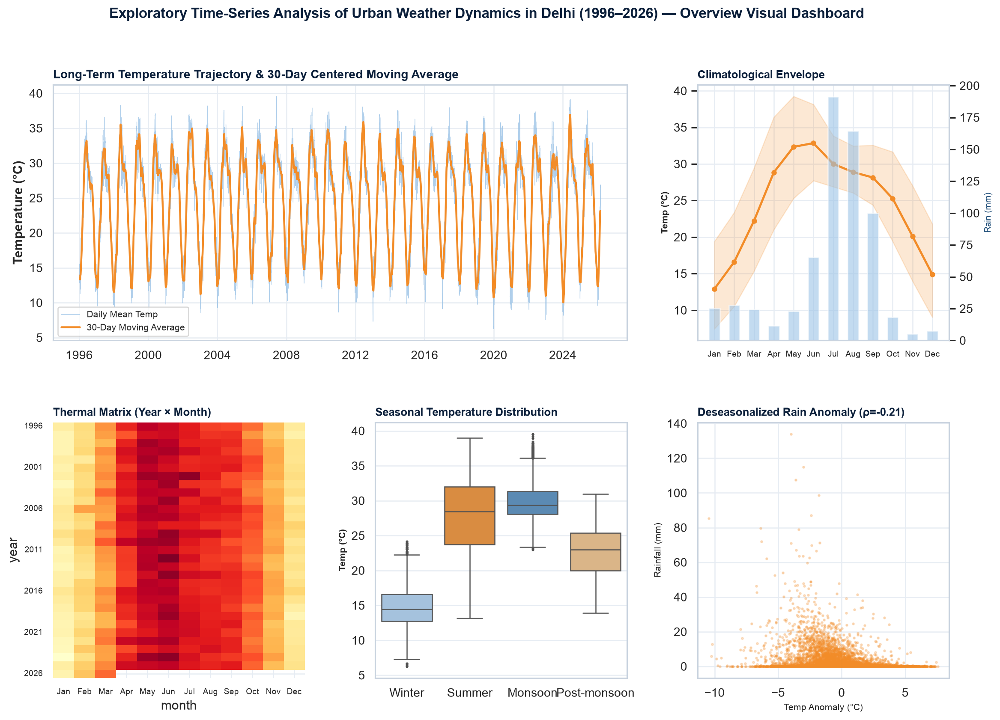
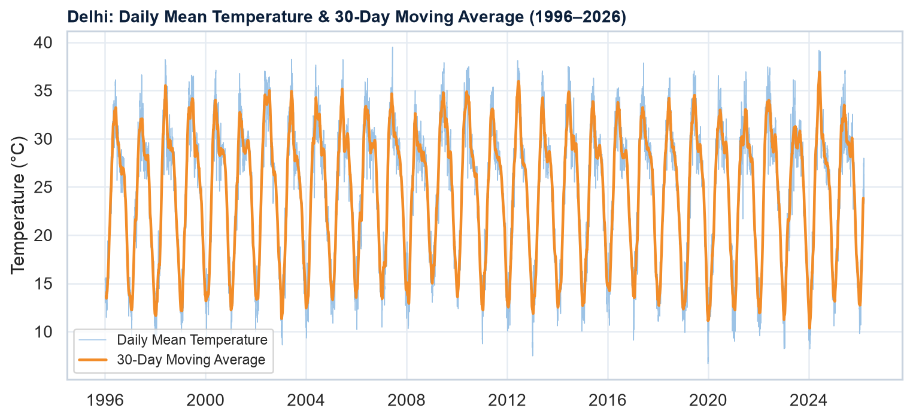
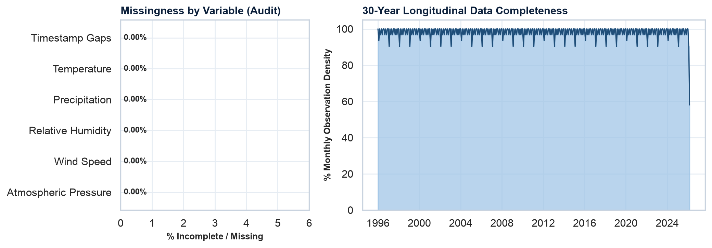
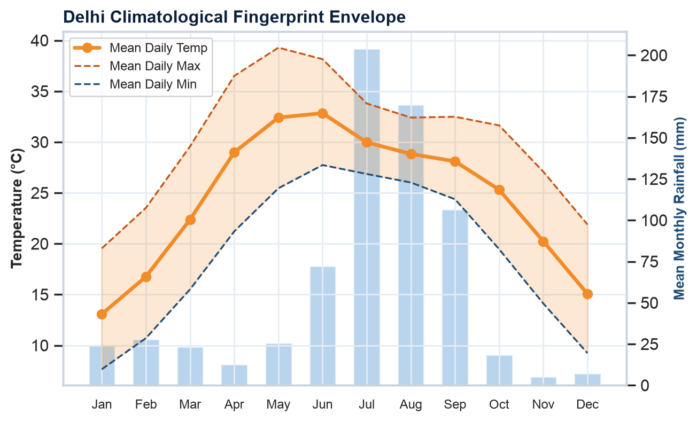
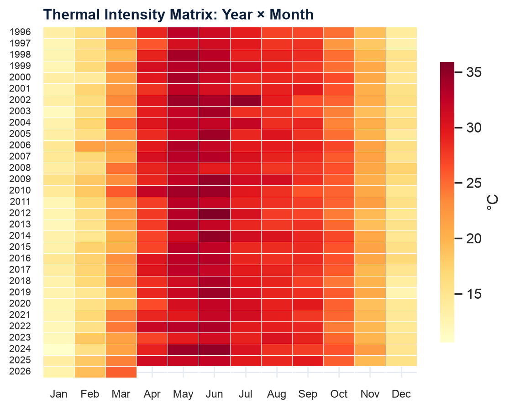
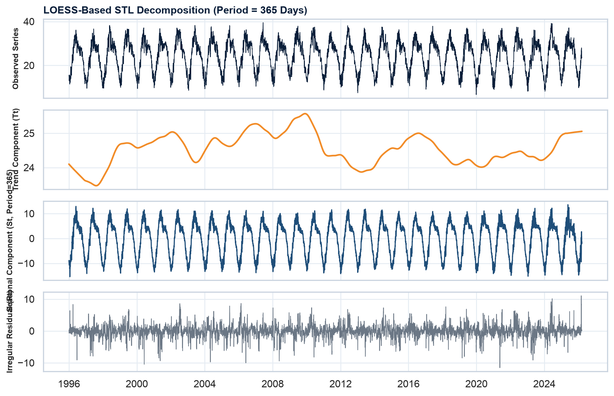
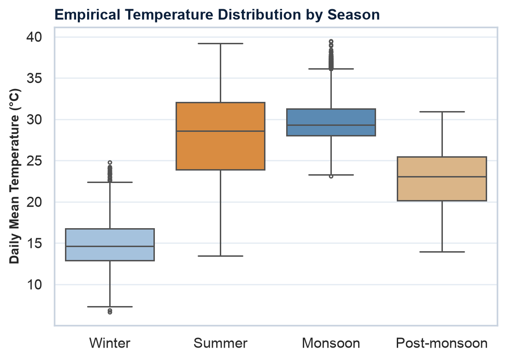
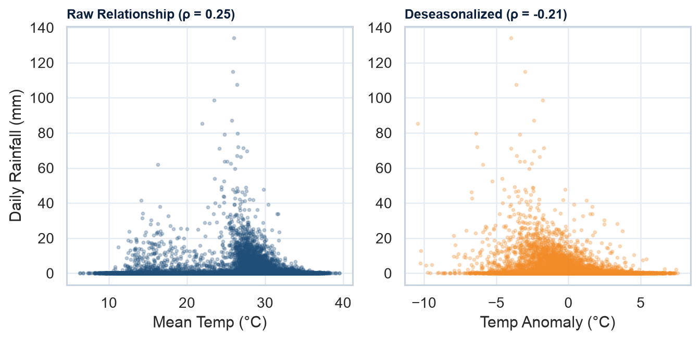

# 🌤️ Delhi Urban Weather Dynamics (1996–2026): Time-Series Analysis

[](https://www.python.org/downloads/)
[](https://creativecommons.org/publicdomain/zero/1.0/)
[-success.svg)]()
[](https://peps.python.org/pep-0008/)
[](index.html)
[](milestone1_output/Milestone1_Synopsis.pptx)

A rigorous, publication-grade **Time-Series Analysis & Exploratory Data Analysis (EDA)** project investigating meteorological and climatological dynamics in **Delhi, India (1 January 1996 to 18 March 2026)** across over **30 continuous years**.

---

## 🌟 Executive Overview Dashboard



> **Figure 00**: *Multi-panel overview dashboard summarizing the 7 exploratory analyses: multi-decadal temperature trajectory, monthly data quality audit, climatological envelope, longitudinal thermal intensity matrix, LOESS STL additive decomposition ($F_s = 0.936$), empirical seasonal boxplots, and temperature-precipitation coupling.*

---

## ⚡ Key Statistical Highlights

| Metric | Empirical Value | Context & Significance |
| :--- | :--- | :--- |
| **Temporal Span** | **1996–2026** (30+ Years) | Longitudinal observation window covering 3 full decades |
| **Observations Analyzed** | **264,840 Hourly** &rarr; **11,035 Daily** | Exceeds the $\ge 500$ observation evaluation threshold by **22&times;** |
| **Data Quality & Continuity** | **0 Duplicates**, **0 Gaps (100.0%)** | 100% continuous monthly and hourly grid |
| **Overall Mean Temperature** | **24.39 °C** (Std: **7.01 °C**) | Delhi's historical subtropical continental baseline |
| **Climatological Extremes** | **Jun (32.85 °C)** vs. **Jan (12.90 °C)** | Annual thermal swing of **19.94 °C** |
| **Seasonal Strength ($F_s$)** | **0.936** (0 to 1 scale) | Overwhelming dominant yearly solar insolation periodicity |
| **Trend Strength ($F_t$)** | **0.082** | Minor long-term secular drift compared to seasonal swing |
| **Monsoon Rain Concentration** | **78.2%** (Jun–Sep) | Heavy summer downpours necessitating municipal flood planning |
| **Temp-Rain Association** | **$\rho_{\text{anom}} = -0.21$** ($p < 10^{-5}$) | Deseasonalized cooling effect from cloud cover and evaporation |
| **Stationarity (ADF Test)** | **Stat: -10.6033** ($p = 6.09 \times 10^{-19}$) | Rejects unit root; stationary around stable mean |
| **Stationarity (KPSS Test)** | **Stat: 0.0185** ($p \ge 0.1000$) | Fails to reject level stationarity |

---

## 📁 Repository Deliverables & Quick Links

- [📊 **Interactive HTML Dashboard** (`index.html`)](index.html) — Full responsive web application with dark/light mode and lightbox chart viewer.
- [📑 **Milestone 1 Synopsis Presentation** (`milestone1_output/Milestone1_Synopsis.pptx`)](milestone1_output/Milestone1_Synopsis.pptx) — Rubric-aligned 12-slide deck with speaker notes.
- [📝 **Milestone 1 Academic Synopsis Report** (`milestone1_output/Milestone1_Synopsis_Report.md`)](milestone1_output/Milestone1_Synopsis_Report.md) — Comprehensive technical report with formal problem framing.
- [📈 **Clean Aggregated Daily Series** (`milestone1_output/daily_series.csv`)](milestone1_output/daily_series.csv) — 11,035 time-indexed daily rows for modeling.
- [🔢 **Exact JSON Statistical Audit** (`milestone1_output/stats.json`)](milestone1_output/stats.json) — Programmatic audit metrics, extremes, and stationarity tests.
- [🖼️ **High-Resolution Figures** (`milestone1_output/figures/`)](milestone1_output/figures/) — 8 publication-grade vector/raster charts.

---

## 📌 1. Project Overview & Domain Context

- **Domain**: Climate & Environmental Science / Urban Meteorology
- **Course**: Time Series Analysis & Forecasting
- **Milestone 1 Scope**: Problem formulation, dataset curation, quality audit, and exploratory analysis (trend, annual seasonality, and LOESS STL decomposition).
- **Evaluation Rule Compliance**: *In strict accordance with project evaluation guidelines, no predictive forecasting models are implemented during the Synopsis (Phase 1) evaluation. Classical baseline models (ARIMA, SARIMA, Holt-Winters) are scheduled for Phase 2.*

### 🎯 Problem Statement
> *How do temperature, precipitation, and atmospheric variables in Delhi evolve across seasonal and multi-decadal horizons (1996–2026), and what empirical properties govern the choice of future forecasting models in subsequent phases?*

### 👥 Target Stakeholders & Decisions Supported
1. **Power Utilities**: Quantifying summer heatwave intensity and cooling degree days to plan peak electricity grid resourcing.
2. **Municipal & Disaster Planners**: Analyzing concentrated monsoon precipitation for urban stormwater, drainage, and flood resilience.
3. **Agronomy & Agriculture**: Tracking seasonal onset and temperature patterns affecting Northern Indian crop cycles.
4. **Public Health Authorities**: Formulating early warning advisories for extreme heatwaves and severe winter cold snaps.

---

## 📊 2. Dataset Description & Schema

- **Source**: Kaggle Indian Weather Dataset 1996–2026 (`sandeepgupta09/indian-weather-dataset-1996-2026`)
- **License**: CC0: Public Domain (verified on Kaggle dataset page)
- **Coverage**: Over 30 years of continuous observations (1 January 1996 to 18 March 2026)
- **Frequency**: Regular hourly observations ($N=264,840$) aggregated to daily points ($N=11,035$)
- **Data Quality**: 0 duplicate timestamps, 0 missing slots, 100% temporal continuity

### Data Dictionary

| Variable | Column Name | Unit | Type | Description |
| :--- | :--- | :--- | :--- | :--- |
| **Timestamp** | `datetime` | ISO-8601 | Datetime | Regular hourly observation time index |
| **Temperature** | `temperature_C` | °C | Float | Ambient air temperature at 2m height |
| **Precipitation** | `precip_mm` | mm | Float | Cumulative liquid rainfall |
| **Relative Humidity**| `humidity_pct` | % | Float | Atmospheric relative moisture percentage |
| **Pressure** | `pressure_hPa` | hPa | Float | Barometric air pressure at sea level |
| **Wind Speed** | `wind_speed_ms` | m/s | Float | Horizontal wind velocity |

---

## 🔍 3. Exploratory Visual Gallery & Scientific Findings

All figures are compiled in `milestone1_output/figures/`:

### Figure 1: Multi-Decadal Temperature Trajectory & 30-Day Moving Average

*Daily mean temperature across 30 years with a 30-day centered moving average (exploratory visual smoothing aid only; no prediction). Demonstrates annual regularity and decadal stability.*

---

### Figure 2: Data Quality & Completeness Audit

*Variable-level completeness audit confirming 0.00% missing values across all primary columns and 100% continuous monthly observation coverage without gaps.*

---

### Figure 3 & 4: Climatological Envelope & 30-Year Thermal Heatmap
| Figure 3: Climatological Envelope | Figure 4: Year × Month Thermal Matrix |
| :---: | :---: |
|  |  |
| *Monthly thermal envelope (mean, max, min) with rainfall. Hottest: **June (32.8°C)**, Coldest: **January (12.9°C)**, Swing: **19.9°C**.* | *2D thermal heatmap demonstrating stable annual seasonality across all 30 individual calendar years.* |

---

### Figure 5: LOESS STL Structural Decomposition

*Additive LOESS decomposition ($Period = 365\text{ days}$) isolating seasonal strength ($F_s = 0.936$), trend strength ($F_t = 0.082$), and residual noise ($\sigma_R = 1.79^\circ\text{C}$). The dominance of $F_s$ provides strong empirical motivation for seasonal models (SARIMA / Holt-Winters) in Phase 2.*

---

### Figure 6 & 7: Seasonal Distributions & Temperature–Precipitation Associations
| Figure 6: Seasonal Boxplots | Figure 7: Temperature vs. Rain Anomaly |
| :---: | :---: |
|  |  |
| *Empirical temperature distributions across Winter, Summer, Monsoon, and Post-Monsoon.* | *Raw association vs. deseasonalized temperature anomaly ($\rho = -0.21$), capturing evaporative cooling.* |

---

## 🌡️ 4. Historical Temperature Extremes in Delhi (1996–2026)

### Top 5 Hottest Recorded Days (Daily Max Temp)
| Rank | Date | Recorded Max Temp | Climatological Context |
| :---: | :--- | :---: | :--- |
| **#1** | **26 May 1998** | **46.9 °C** | Historic Northern India severe heatwave |
| **#2** | **30 May 2024** | **46.2 °C** | Extreme early-summer peak heatwave |
| **#3** | **28 May 1998** | **46.2 °C** | Multi-day persistent high-pressure ridge |
| **#4** | **29 May 2024** | **46.1 °C** | Prolonged pre-monsoon thermal spike |
| **#5** | **24 May 1998** | **46.0 °C** | Sustained dry westerly winds (Loo) |

### Top 5 Coldest Recorded Days (Daily Min Temp)
| Rank | Date | Recorded Min Temp | Climatological Context |
| :---: | :--- | :---: | :--- |
| **#1** | **31 Dec 2019** | **1.3 °C** | Record-breaking December cold spell |
| **#2** | **06 Jan 2013** | **1.9 °C** | Severe winter radiation inversion |
| **#3** | **01 Jan 2020** | **1.9 °C** | Prolonged cold-day conditions |
| **#4** | **28 Dec 2019** | **2.0 °C** | Dense radiation fog episode |
| **#5** | **30 Dec 2019** | **2.2 °C** | Arctic continental air intrusion |

---

## 🔬 5. Review of Existing Systems & Feasibility (Rubric Criterion)

| Approach | Key Characteristics | Typical Limitations | Project Direction |
| :--- | :--- | :--- | :--- |
| **Numerical Weather Prediction (NWP)** | Physics-based fluid dynamics | Heavy supercomputing overhead; physical grid tuning | Benchmark context; out of scope for time series |
| **Classical Statistical (ARIMA / SARIMA)** | Linear autoregressive modeling | Assumes linearity; limited with complex non-linear patterns | Planned Phase 2 baseline models |
| **Holt-Winters Exponential Smoothing** | Triple exponential smoothing | Fixed linear smoothing parameters | Planned Phase 2 baseline comparison |
| **LOESS Seasonal Decomposition (STL)** | Non-parametric loess smoothing | Descriptive; requires separate forecasting mechanism | Phase 1 exploratory tool (Completed) |
| **Machine Learning (XGBoost)** | Gradient boosted decision trees | Requires extensive manual lag/rolling feature engineering | Planned Phase 3 ensemble benchmark |
| **Deep Learning (LSTM) & Prophet** | Recurrent sequence & additive models | Heavier training compute; sequence length sensitivity | Planned Phase 3 advanced comparison |

### Technical Feasibility
- **Data Volume**: 11,035 daily points ($\ge 500$ requirement satisfied).
- **Tooling**: Pure Python stack using `pandas`, `matplotlib`, `seaborn`, and `statsmodels`.
- **Phase Alignment**: Feasible 3-phase execution matching course milestones.

---

## 📑 6. Synopsis Presentation Deck Structure (12 Slides)

The compiled PowerPoint presentation (`milestone1_output/Milestone1_Synopsis.pptx`) strictly adheres to the 12-slide ceiling:

| Slide | Title | Key Contents & Evaluation Rubric Alignment |
| :---: | :--- | :--- |
| **01** | Cover Slide | Project title, academic course, team information, guide details |
| **02** | Introduction & Motivation | Time-series fundamentals, Delhi subtropical climate, urban relevance |
| **03** | Problem Framing & Scope | Research question, stakeholder mapping (utilities, municipal, health) |
| **04** | Dataset Description & Snapshot | Source verification, CC0 license, variables dictionary, raw sample table |
| **05** | Data Quality Audit | 264,840 hourly rows, 0 duplicate timestamps, 100% temporal continuity |
| **06** | Trend & Extreme Analysis | 30-day moving average trajectory, top 5 hottest and coldest recorded days |
| **07** | Seasonality & Heatmap | Climatological envelope, 19.9°C thermal swing, 30-year thermal matrix |
| **08** | LOESS STL Decomposition | Structural separation: Trend, Seasonality ($F_s = 0.936$), and Residuals |
| **09** | Distributions & Rain Coupling | Seasonal boxplots, 78% monsoon concentration, temp anomaly correlation |
| **10** | Existing Systems & Feasibility | Literature review matrix (NWP, ARIMA, XGBoost, LSTM) & feasibility check |
| **11** | Objectives & Methodology | 7-point roadmap, stationarity tests (ADF/KPSS), split protocol |
| **12** | Conclusion & References | Milestone 1 synthesis, next phase action items, 9 academic citations |

---

## 🚀 7. Proposed Multi-Phase Roadmap

```mermaid
graph LR
    A[Milestone 1: Synopsis & EDA] --> B[Milestone 2: Classical Models]
    B --> C[Milestone 3: Advanced ML/DL & Evaluation]
    
    subgraph Milestone 1 (Completed)
        A1[Data Quality & Continuity Audit]
        A2[Climatological Envelope & Extremes]
        A3[LOESS STL Decomposition]
        A4[Stationarity Diagnostics: ADF/KPSS]
    end
    
    subgraph Milestone 2 (Mid-Sem)
        B1[Stationarity Checks: ADF & KPSS Tests]
        B2[ACF / PACF Parameter Diagnostics]
        B3[ARIMA, SARIMA & Holt-Winters Models]
        B4[Baseline Error Metrics: RMSE, MAE, MAPE]
    end
    
    subgraph Milestone 3 (Final)
        C1[XGBoost with Lag Features]
        C2[LSTM Neural Network]
        C3[Facebook Prophet]
        C4[Comparative Benchmark & Stakeholder Framework]
    end
```

---

## 🛠️ 8. Quickstart & Execution

### 1. Installation
```bash
# Clone the repository
git clone https://github.com/dhruvsaini-code/weather-forecasting.git
cd weather-forecasting

# Install dependencies
pip install -r requirements.txt
```

### 2. Run the Pipeline
```bash
# Standard run (generates figures, stats, presentation, and HTML dashboard)
python milestone1_pipeline.py

# Headless mode (ideal for CI, servers, or batch execution)
python milestone1_pipeline.py --headless

# Interactive mode (opens interactive matplotlib display)
python milestone1_pipeline.py --interactive
```

---

## 📚 9. Academic References

1. **Hyndman, R. J., & Athanasopoulos, G.** (2021). *Forecasting: Principles and Practice* (3rd ed.). OTexts.
2. **Box, G. E. P., Jenkins, G. M., Reinsel, G. C., & Ljung, G. M.** (2015). *Time Series Analysis: Forecasting and Control* (5th ed.). John Wiley & Sons.
3. **Cleveland, R. B., Cleveland, W. S., McRae, J. E., & Terpenning, I.** (1990). *STL: A Seasonal-Trend Decomposition Procedure Based on Loess*. Journal of Official Statistics, 6(1), 3–73.
4. **Taylor, S. J., & Letham, B.** (2018). *Forecasting at Scale*. The American Statistician, 72(1), 37–45.
5. **Hochreiter, S., & Schmidhuber, J.** (1997). *Long Short-Term Memory*. Neural Computation, 9(8), 1735–1780.
6. **Chen, T., & Guestrin, C.** (2016). *XGBoost: A Scalable Tree Boosting System*. ACM SIGKDD, 785–794.
7. **Bauer, P., Thorpe, A., & Brunet, G.** (2015). *The Quiet Revolution of Numerical Weather Prediction*. Nature, 525(7567), 47–55.
8. **Rasp, S. et al.** (2020). *WeatherBench: A Benchmark Data Set for Data-Driven Weather Forecasting*. JAMES, 12(11), e2020MS002203.
9. **Kaggle Dataset**: *Indian Weather Dataset (1996–2026)*, sandeepgupta09. License: CC0: Public Domain.
