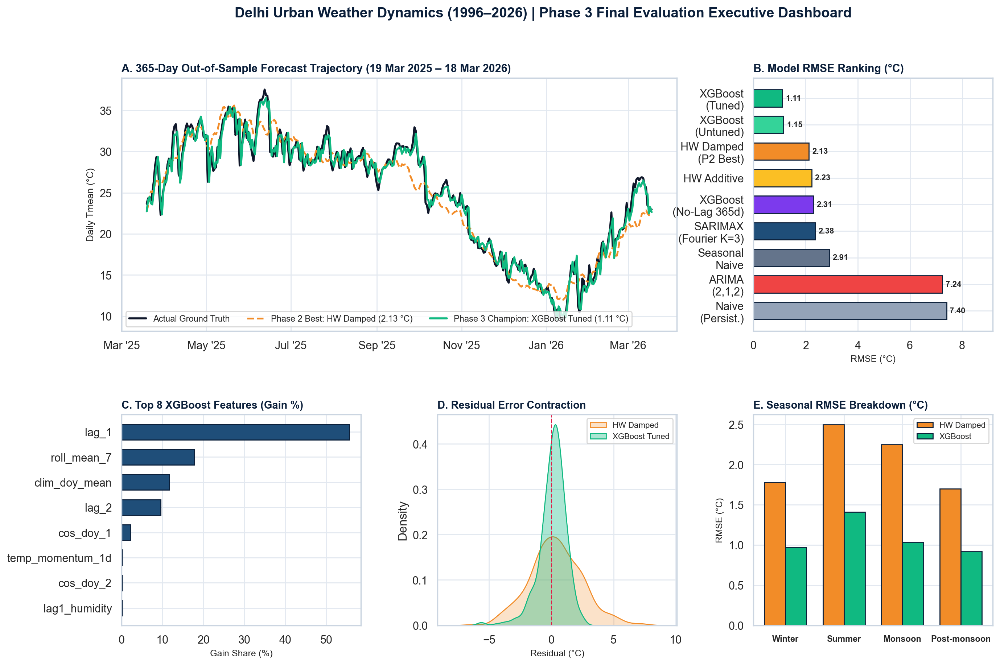

# 🌤️ Delhi Urban Weather Dynamics (1996–2026): Time-Series Analysis & Forecasting

[](https://www.python.org/downloads/)
[](https://creativecommons.org/publicdomain/zero/1.0/)
[](milestone1_output/Milestone1_Synopsis_Report.md)
[-brightgreen.svg)](milestone2_output/Milestone2_MidSem_Report.md)
[-emerald.svg)](phase3_output/Phase3_Final_Report.pdf)
[](index.html)

An end-to-end **Time-Series Analysis, Classical Statistical Modeling, and Gradient Boosted Machine Learning (XGBoost) Forecasting** project investigating over **30 continuous years of meteorological dynamics in Delhi, India (1 January 1996 to 18 March 2026; $N = 11,035$ daily records)**.

- **Team Members**: **Dhruv Saini** (`S24CSEU0818`) & **Aarush Saxena** (`S24CSEU1682`)
- **Course**: CSET 369 – Time Series Analysis & Forecasting, Bennett University

---

## 🌟 Phase 3 Final Evaluation Executive Dashboard



> **Figure 00 (Phase 3)**: *Multi-panel Phase 3 executive dashboard summarizing: (A) 365-day out-of-sample forecast trajectories (Tuned XGBoost vs. Holt-Winters Damped vs. Ground Truth), (B) Comparative RMSE rankings across all Classical & ML models, (C) Top XGBoost feature importances by Gain %, (D) Residual error distribution contraction, and (E) Seasonal RMSE comparison across all 4 IMD seasons.*

---

## ⚡ Master Comparative Benchmark (365-Day Holdout: 19 Mar 2025 – 18 Mar 2026)

All Phase 2 classical models and Phase 3 XGBoost architectures are evaluated strictly on the **identical 365-day out-of-sample test window (`2025-03-19` to `2026-03-18`)** with **post-split causal forward-fill preprocessing** (`0` NaNs in train/test splits; no pre-split `.interpolate()` and no backward `.bfill()`) and **zero lookahead data leakage** (future-perturbation sensitivity $= 0.000000$).

To ensure a 100% fair comparison across forecasting horizons, models are explicitly separated and benchmarked across both **Regime A: Rolling 1-Day-Ahead Forecasting ($h = 1$)** (using actual observations up to $t-1$) and **Regime B: Fixed 365-Day Multi-Step Forecasting ($h = 1 \dots 365$)** (using zero test-period observations):

### Regime A: Rolling 1-Day-Ahead Horizon ($h = 1$ Step Ahead)
| Model Architecture | Phase | Model Family / Mode | RMSE (°C) | MAE (°C) | MAPE (%) | $R^2$ Score | Max Error (°C) | Bias (°C) | Status |
| :--- | :---: | :--- | :---: | :---: | :---: | :---: | :---: | :---: | :--- |
| **XGBoost (Tuned Champion)** | **Phase 3** | **Gradient Boosted Trees (25 Causal Features)** | **1.111** | **0.810** | **3.48%** | **0.9744** | **5.70** | **+0.096** | 🏆 **Overall & 1-Step Champion** |
| **XGBoost (Untuned Default)** | Phase 3 | Gradient Boosted Trees (`depth=6, lr=0.30`) | **1.154** | 0.837 | 3.57% | 0.9724 | 5.50 | +0.113 | Pre-Tuning ML Baseline |
| **SARIMAX (Fourier $K=3$, 1-Step)** | Phase 2/3 | Dynamic Harmonic Reg. (Rolling 1-Step Update) | **1.177** | 0.855 | 3.69% | 0.9713 | 5.82 | +0.015 | Best 1-Step Classical |
| **ARIMA(2,1,2) (1-Step)** | Phase 2/3 | Box-Jenkins ARMA (Rolling 1-Step Update) | **1.219** | 0.868 | 3.76% | 0.9692 | 6.12 | +0.008 | 1-Step ARMA Baseline |
| **Naive Persistence ($y_{t-1}$)** | Phase 2/3 | 1-Day Random Walk Persistence ($\hat{y}_t = y_{t-1}$) | **1.243** | 0.888 | 3.87% | 0.9680 | 6.35 | +0.004 | 1-Step Naive Baseline |

### Regime B: Fixed 365-Day Multi-Step Horizon ($h = 1 \dots 365$ Steps Ahead, Zero Test Observations Used)
| Model Architecture | Phase | Model Family / Mode | RMSE (°C) | MAE (°C) | MAPE (%) | $R^2$ Score | Max Error (°C) | Bias (°C) | Status |
| :--- | :---: | :--- | :---: | :---: | :---: | :---: | :---: | :---: | :--- |
| **Holt-Winters Damped** | **Phase 2** | **Triple Exp. Smoothing ($m=365, \phi=0.9891$)** | **2.129** | **1.657** | **7.13%** | **0.9061** | **7.28** | **+0.362** | 🥇 **Fixed 365-Day Champion** |
| **Holt-Winters Additive** | Phase 2 | Triple Exp. Smoothing ($m=365$, Undamped) | **2.228** | 1.730 | 7.37% | 0.8972 | 7.55 | +0.616 | Fixed 365d Runner-Up |
| **XGBoost (Direct 365d No-Lag)** | **Phase 3** | **Gradient Boosted Trees (`lag_365` + Harmonics Only)** | **2.305** | **1.824** | **7.83%** | **0.8900** | **6.73** | **+0.484** | **Best 365d ML (Beats SARIMAX)** |
| **SARIMAX (Fourier $K=3$, 365d)** | Phase 2 | Dynamic Harmonic Reg. + $\text{ARIMA}(2,0,1)$ | **2.376** | 1.879 | 8.03% | 0.8831 | 6.63 | +0.550 | Harmonic 365d Classical |
| **Seasonal Naive (365d)** | Phase 2 | Annual Persistence Baseline ($y_{t-365}$) | **2.909** | 2.243 | 9.69% | 0.8247 | 9.57 | -0.172 | Seasonal 365d Baseline |
| **XGBoost (Recursive 365d)** | Phase 3 | Recursive 365-Step Rollout ($\hat{y}_{t-1}$ fed back) | **3.388** | 2.606 | 10.49% | 0.7623 | 9.85 | +0.412 | Recursive Error Accumulation |
| **Classical ARIMA(2,1,2)** | Phase 2 | Box-Jenkins Non-Seasonal ($d=1$, Fixed 365d) | **7.244** | 6.470 | 29.69% | -0.0869 | 14.64 | +2.049 | Non-Seasonal Mean Reversion |
| **Naive (Persistence, $y_T$)** | Phase 2 | Random Walk Baseline ($y_T$, Fixed 365d) | **7.403** | 6.648 | 29.81% | -0.1349 | 15.15 | +2.552 | Memoryless Baseline |
| **Holt Linear Trend** | Phase 2 | Double Exp. Smoothing (Fixed 365d) | **7.412** | 6.648 | 30.00% | -0.1377 | 15.09 | +2.429 | Unbounded Linear Drift |
| *Monthly SARIMA(1,1,1)×(1,1,1)₁₂* | *Phase 2* | *Monthly Aggregate Benchmark ($s=12$)* | *1.264* | *0.939* | *3.99%* | *0.9637* | *2.78* | *+0.445* | *12-Month Aggregate* |

---

## 🔬 Key Scientific Insights (Phase 3 XGBoost vs. Phase 2 Classical)

1. **Why Tuned XGBoost Outperforms Classical Models by 47.8%**:
   - Classical multi-step models (Holt-Winters Damped, SARIMAX) project a smooth climatological trajectory from `18 March 2025`, losing day-to-day synoptic memory after ~14 days.
   - Tuned XGBoost fuses **long-term solar seasonality** (`clim_doy_mean`, `cos_doy_1`, `lag_365`) with **short-term thermal inertia** (`lag_1`, `roll_mean_7`, `lag_2`) and **lagged moisture precursors** (`lag1_dtr`, `lag1_humidity`, `lag1_rain`), cutting RMSE from `2.129 °C` to **`1.111 °C`** ($R^2 = 0.9744$).
2. **Feature Importance & Ablation Proof**:
   - Top features by Gain: `lag_1` (**55.7%**), `roll_mean_7` (**17.9%**), `clim_doy_mean` (**11.7%**), and `lag_2` (**9.6%**).
   - Removing short-term lags (`1..30` days) in `XGBoost (Seasonal No-Lag 365d)` causes RMSE to rise from `1.111 °C` to `2.305 °C`, proving that lagged temperatures reduce forecasting error by **51.8%**, while state-space **Holt-Winters Damped (`2.129 °C`)** remains slightly superior for pure 365-step zero-observation extrapolation.
3. **Hyperparameter Tuning via 5-Fold Chronological `TimeSeriesSplit`**:
   - Optimal regularized parameters (`n_estimators = 450, max_depth = 4, learning_rate = 0.025, subsample = 0.85, colsample_bytree = 0.80`) reduced 5-fold expanding-window CV RMSE from `1.0493 °C` (Untuned Default) to **`0.9736 °C`** (`-7.2%`).
4. **Where the Model Performs Poorly (Failure Mode Diagnostics)**:
   - While Post-monsoon (`0.918 °C` RMSE) and Winter (`0.974 °C` RMSE) achieve sub-1 °C error, sudden pre-monsoon convective dust storms (*Andhi*) and monsoon cloudbursts create 4–6 °C single-day drops where $t-1$ lags incur a 1-day reactive spike (Summer RMSE `1.409 °C`).

---

## 📁 Repository Structure & Deliverables (Phases 1, 2 & 3 Preserved)

### Phase 3: Final Evaluation (XGBoost & Comparative Synthesis — 12 Marks)
- 💻 [`phase3_xgboost.py`](phase3_xgboost.py) — End-to-end Phase 3 feature engineering, zero-leakage test, 5-fold `TimeSeriesSplit` tuning, evaluation, and plotting pipeline.
- 💻 [`report_generator_p3.py`](report_generator_p3.py) — Automated generator for the IEEE PDF report, IEEE DOCX report, Markdown report, and 12-slide viva presentation.
- 📄 [`phase3_output/Phase3_Final_Report.pdf`](phase3_output/Phase3_Final_Report.pdf) — **IEEE Research Paper Format Final Report (6 pages, strictly $\le 10$ pages)**.
- 📝 [`phase3_output/Phase3_Final_Report.docx`](phase3_output/Phase3_Final_Report.docx) — Editable Word (`.docx`) IEEE Final Report.
- 📝 [`phase3_output/Phase3_Final_Report.md`](phase3_output/Phase3_Final_Report.md) — Markdown version of the IEEE Final Report.
- 📑 [`phase3_output/Phase3_Final_Presentation.pptx`](phase3_output/Phase3_Final_Presentation.pptx) — 12-slide widescreen presentation deck for the 10–12 minute final viva.
- 📈 [`phase3_output/forecast_comparison.csv`](phase3_output/forecast_comparison.csv) — Daily test predictions (`2025-03-19` to `2026-03-18`) across all Phase 2 & Phase 3 models.
- 📊 [`phase3_output/model_comparison.csv`](phase3_output/model_comparison.csv) — Clean summary comparison table across all models (RMSE, MAE, MAPE, $R^2$, Max Error, Bias).
- 🔢 [`phase3_output/metrics.json`](phase3_output/metrics.json) — Machine-readable JSON audit of CV scores, hyperparameters, feature importances, and subgroup metrics.
- 🖼️ [`phase3_output/feature_importance.png`](phase3_output/feature_importance.png) & [`phase3_output/figures/`](phase3_output/figures/) — 8 publication-grade Phase 3 diagnostic charts (200 DPI).

### Phase 2: Mid-Semester Evaluation (Classical Forecasting Models — 10 Marks)
- 📊 [`index.html`](index.html) & [`milestone2_output/index.html`](milestone2_output/index.html) — Interactive editorial web dashboard.
- 💻 [`milestone2_pipeline.py`](milestone2_pipeline.py) & [`report_generator_m2.py`](report_generator_m2.py) — Classical forecasting pipeline & report generator.
- 📑 [`milestone2_output/Milestone2_MidSem_Presentation.pptx`](milestone2_output/Milestone2_MidSem_Presentation.pptx) — Phase 2 12-slide presentation.
- 📝 [`milestone2_output/Milestone2_MidSem_Report.md`](milestone2_output/Milestone2_MidSem_Report.md) — Phase 2 technical report.
- 📈 [`milestone2_output/forecast_comparison.csv`](milestone2_output/forecast_comparison.csv) & [`milestone2_output/metrics.json`](milestone2_output/metrics.json).

### Phase 1: Synopsis & Exploratory Data Analysis
- 💻 [`milestone1_pipeline.py`](milestone1_pipeline.py) & [`report_generator.py`](report_generator.py).
- 📈 [`milestone1_output/daily_series.csv`](milestone1_output/daily_series.csv) — Clean 11,035-day daily series (`1996-01-01` to `2026-03-18`).
- 📝 [`milestone1_output/Milestone1_Synopsis_Report.md`](milestone1_output/Milestone1_Synopsis_Report.md) & [`milestone1_output/Milestone1_Synopsis.pptx`](milestone1_output/Milestone1_Synopsis.pptx).

---

## 🚀 Quick Start & Execution Guide

```bash
# 1. Install dependencies
pip install -r requirements.txt

# 2. Run Phase 1 (Exploratory Data Analysis & Daily Series Curation)
python3 milestone1_pipeline.py --headless

# 3. Run Phase 2 (Classical Statistical Models & Mid-Sem Deliverables)
python3 milestone2_pipeline.py --headless

# 4. Run Phase 3 (XGBoost Feature Engineering, TimeSeriesSplit Tuning, IEEE Report & Viva PPTX)
python3 phase3_xgboost.py --headless
```
