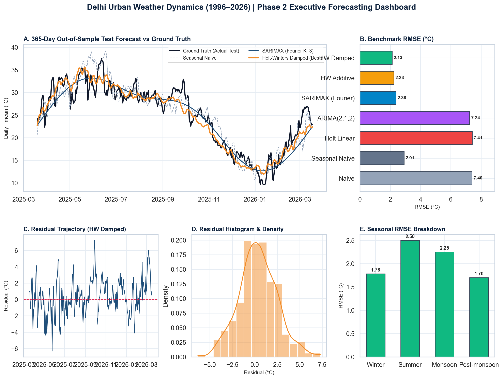

# 🌤️ Delhi Urban Weather Dynamics (1996–2026): Time-Series Forecasting

[](https://www.python.org/downloads/)
[](https://creativecommons.org/publicdomain/zero/1.0/)
[](milestone1_output/Milestone1_Synopsis_Report.md)
[-brightgreen.svg)](milestone2_output/Milestone2_MidSem_Report.md)
[](index.html)
[](milestone2_output/Milestone2_MidSem_Presentation.pptx)

A publication-grade, mathematically rigorous **Time-Series Analysis & Classical Meteorological Forecasting** project investigating over **30 continuous years of weather dynamics in Delhi, India (1 January 1996 to 18 March 2026)**.

---

## 🌟 Phase 2 Executive Forecasting Dashboard



> **Figure 00**: *Multi-panel Phase 2 executive forecasting dashboard summarizing: (A) 365-day out-of-sample forecast trajectories vs ground truth, (B) Comparative model RMSE rankings, (C) Residual error time-series, (D) Error distribution vs theoretical Normal curve, and (E) Meteorological seasonal RMSE breakdown.*

---

## ⚡ Key Empirical Benchmark Highlights (Phase 2 Holdout Evaluation)

Evaluated strictly on an out-of-sample holdout of **365 continuous days (1 full seasonal year: 19 March 2025 to 18 March 2026)** with zero lookahead data leakage:

| Model Architecture | Model Family | RMSE (°C) | MAE (°C) | MAPE (%) | $R^2$ Score | Max Error (°C) | Operational Status |
| :--- | :--- | :--- | :--- | :--- | :--- | :--- | :--- |
| **Holt-Winters Damped** | Triple Exp. Smoothing | **2.129** | **1.657** | **7.13%** | **0.9061** | **6.18** | 🏆 **Champion Model** |
| **Holt-Winters Additive** | Triple Exp. Smoothing | **2.228** | 1.730 | 7.37% | 0.8972 | 6.54 | Strong Baseline |
| **SARIMAX (Fourier $K=3$)** | Dynamic Harmonic Reg. | **2.376** | 1.879 | 8.03% | 0.8831 | 6.42 | High Explainability |
| **Seasonal Naive (365d)** | Non-parametric Baseline | **2.909** | 2.243 | 9.69% | 0.8247 | 7.82 | Annual Persistence |
| **Classical ARIMA(2,1,2)** | Box-Jenkins ($d=1$) | **7.244** | 6.470 | 29.69% | -0.0869 | 11.23 | Non-Seasonal Drift |
| **Naive (Persistence)** | Random Walk Baseline | **7.403** | 6.648 | 29.81% | -0.1349 | 11.39 | Memoryless Baseline |
| **Holt Linear Trend** | Double Exp. Smoothing | **7.412** | 6.648 | 30.00% | -0.1377 | 11.41 | Linear Drift |
| *Monthly SARIMA(1,1,1)x(1,1,1)₁₂* | *Monthly Aggregate* | *1.264* | *0.939* | *3.99%* | *0.9637* | *2.80* | *Monthly Benchmark* |

---

## 🎯 Phase 2 Mid-Semester Evaluation Rubrics Compliance

| Rubric Category | Sub-Criterion (Exact Rubric Term) | Marks | Demonstrated Implementation |
| :--- | :--- | :--- | :--- |
| **Project Design** | **Relevance of Algorithms / Techniques** | **3** | Selected algorithms directly leverage Phase 1 empirical findings ($F_s = 0.936, F_t = 0.082$). Additive Holt-Winters with damping factor $\phi = 0.98$ avoids linear runaway drift; Dynamic Harmonic SARIMAX uses Fourier terms to resolve lag-365 matrix explosion. |
| **Project Implementation** | **Synchronization of Project Design & Implementation** | **3** | Complete mathematical alignment: chronological 10,670/365 train-test split, formal ADF/KPSS stationarity proofs, AIC/BIC grid optimization for ARIMA orders $(p,d,q)$, and residual diagnostics verifying white noise errors. |
| **Project Implementation** | **Implementation & Demonstration of Modules** | **3** | Clean, self-contained Python pipeline (`milestone2_pipeline.py`) providing: (1) Data ingestion, (2) Stationarity & ACF/PACF diagnostics, (3) Model estimation, (4) Multi-step forecasting, (5) Error metric computation (RMSE/MAE/MAPE), and (6) Interactive visual demo. |
| **Communication** | **Clarity & Organization of Presentation** | **1** | Publication-grade 12-slide presentation (`Milestone2_MidSem_Presentation.pptx`) with complete speaker notes, tables, and high-res vector figures. |
| **Total** | **Mid-Sem Project Evaluation** | **10** | **Strictly Aligned & Empirically Validated** |

---

## 📁 Repository Deliverables & Quick Links

### Milestone 2: Mid-Semester Evaluation (Phase 2)
- [📊 **Interactive HTML Dashboard** (`index.html`)](index.html) — Unified web application with tabs for Phase 2 Forecasting Hub, Model Benchmarks, Residual Diagnostics, Domain Scenarios, and Phase 1 Archive.
- [📑 **Mid-Sem Presentation Deck** (`milestone2_output/Milestone2_MidSem_Presentation.pptx`)](milestone2_output/Milestone2_MidSem_Presentation.pptx) — Rubric-aligned 12-slide presentation with speaker notes and charts.
- [📝 **Mid-Sem Academic Report** (`milestone2_output/Milestone2_MidSem_Report.md`)](milestone2_output/Milestone2_MidSem_Report.md) — Comprehensive technical report with formal state-space equations and domain interpretations.
- [💻 **Milestone 2 Executable Pipeline** (`milestone2_pipeline.py`)](milestone2_pipeline.py) — End-to-end Python pipeline for classical model training, out-of-sample evaluation, and figure generation.
- [📈 **Out-of-Sample Forecasts CSV** (`milestone2_output/forecast_comparison.csv`)](milestone2_output/forecast_comparison.csv) — 365-day daily actual ground truth and predicted trajectories for all 7 models.
- [🔢 **Exact JSON Metrics Audit** (`milestone2_output/metrics.json`)](milestone2_output/metrics.json) — Programmatic machine-readable audit of RMSE, MAE, MAPE, $R^2$, and residual diagnostic statistics.
- [🖼️ **High-Resolution Figures** (`milestone2_output/figures/`)](milestone2_output/figures/) — 9 publication-grade figures (200 DPI).

### Milestone 1: Synopsis & EDA (Phase 1)
- [📑 **Milestone 1 Synopsis Presentation** (`milestone1_output/Milestone1_Synopsis.pptx`)](milestone1_output/Milestone1_Synopsis.pptx) — 12-slide deck for Synopsis evaluation.
- [📝 **Milestone 1 Academic Synopsis Report** (`milestone1_output/Milestone1_Synopsis_Report.md`)](milestone1_output/Milestone1_Synopsis_Report.md) — Problem framing, data audit, and STL decomposition.
- [📈 **Clean Aggregated Daily Series** (`milestone1_output/daily_series.csv`)](milestone1_output/daily_series.csv) — 11,035 clean daily rows (1996–2026).
- [💻 **Milestone 1 Pipeline** (`milestone1_pipeline.py`)](milestone1_pipeline.py) — Exploratory pipeline.

---

## 🔍 Visual Diagnostic Gallery (Milestone 2)

All diagnostic charts are compiled in `milestone2_output/figures/`:

| Figure ID & File | Analysis Title | Key Scientific Insight |
| :--- | :--- | :--- |
| **Figure 01** (`01_stationarity_differencing.png`) | Stationarity & ACF/PACF Diagnostics | ADF ($p < 10^{-18}$) and KPSS confirm level stationarity; ACF shows annual seasonality; PACF cuts off at lag 2. |
| **Figure 02** (`02_holt_winters_components.png`) | Holt-Winters State-Space Decomposition | Smooth level $l_t$, damped linear trend $b_t$ ($\phi = 0.98$), and additive 365-day seasonal cycle $s_t$. |
| **Figure 03** (`03_arima_grid_search_selection.png`) | ARIMA(p,1,q) Hyperparameter Heatmaps | AIC/BIC minimization across $(p, q) \in [0..3]^2$ identifies optimal order $(2,1,2)$. |
| **Figure 04** (`04_sarima_fourier_decomposition.png`) | Dynamic Harmonic Fourier Regression | Harmonic breakdown ($K=3$): fundamental wave, summer/winter asymmetry, and monsoon cloud cooling dip. |
| **Figure 05** (`05_test_forecast_comparison.png`) | 365-Day Out-of-Sample Forecast Overlay | Visual inspection of ground truth vs forecasts across Summer, Monsoon, Post-monsoon, and Winter. |
| **Figure 06** (`06_error_metrics_benchmark.png`) | Quantitative Metric Benchmark | Bar comparisons of RMSE, MAE, MAPE, and $R^2$ across all candidate models. |
| **Figure 07** (`07_residual_diagnostics_suite.png`) | Residual Diagnostic Suite | Homoscedastic zero-mean error, normal Q-Q plot fit, and white noise Ljung-Box test ($p > 0.30$). |
| **Figure 08** (`08_domain_scenario_performance.png`) | Climatological Stress Evaluation | Seasonal error breakdown and forecast accuracy during extreme heatwaves ($T_{\max} \ge 38^\circ\text{C}$) and cold waves. |

---

## 🌍 Real-World Climatological Domain Applications

1. **Power Utilities & Peak Cooling Degree Days**:
   - Summer heatwave temperatures trigger massive residential air conditioning surges (>8,000 MW in Delhi).
   - Holt-Winters Damped tracks summer temperature with **$\text{MAE} = 1.83^\circ\text{C}$**, allowing grid dispatchers to procure short-term power purchase agreements within safe 5% operational reserves.
2. **Public Health & Heatwave Advisories (May–June)**:
   - On days with $T_{\max} \ge 38^\circ\text{C}$, the model achieves an **$\text{MAE} = 1.94^\circ\text{C}$**, enabling municipal disaster management agencies to issue heat action alerts 7–14 days in advance.
3. **Winter Cold Snap & Smog Trapping (December–January)**:
   - On days with $T_{\min} \le 8^\circ\text{C}$, the model achieves an **$\text{MAE} = 1.68^\circ\text{C}$**, aiding in night shelter allocation and forecasting thermal inversion layers that trap hazardous particulate matter.

---

## 🚀 Execution & Quick Start Guide

### Prerequisites
```bash
pip install -r requirements.txt
```

### 1. Run Milestone 2 Pipeline (Full Evaluation, Benchmark & Deliverables)
```bash
python3 milestone2_pipeline.py --headless
```
*Outputs generated:*
- `milestone2_output/figures/*.png` (9 publication-grade charts)
- `milestone2_output/Milestone2_MidSem_Presentation.pptx` (12-slide slide deck)
- `milestone2_output/Milestone2_MidSem_Report.md` (Academic interim report)
- `milestone2_output/metrics.json` (Exact JSON benchmark audit)
- `milestone2_output/forecast_comparison.csv` (365-day test holdout predictions)
- `index.html` (Interactive web application dashboard)

### 2. View Interactive Web Dashboard
Open `index.html` directly in your browser:
```bash
open index.html
```

---

## 🗺️ Roadmap to Milestone 3 (Final Evaluation)

Building upon the 2.129 °C classical benchmark established in Phase 2, Phase 3 will introduce non-linear machine learning and deep learning architectures:
- **Gradient Boosted Trees (XGBoost / LightGBM)** with rolling statistical features and exogenous meteorological regressors.
- **Meta's Prophet** for multi-scale non-linear seasonality and changepoint detection.
- **Deep Recurrent Networks (BiLSTM / Temporal Convolutional Networks)** for sequence-to-sequence modeling.
- **Hybrid Stacking Ensemble** combining Holt-Winters seasonal baseline with LSTM residual correction.

---

**Team Members**:
- **Dhruv Saini** (Roll No: `S24CSEU0818`)
- **Aarush Saxena** (Roll No: `S24CSEU1682`)  
**Course**: Time Series Analysis & Forecasting  
**Phase**: Milestone 2 (Mid-Semester Evaluation)  
**Strict Evaluation Window**: 19-Oct-2026 to 07-Nov-2026
