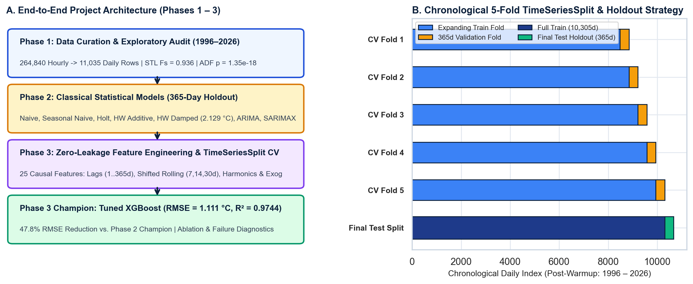
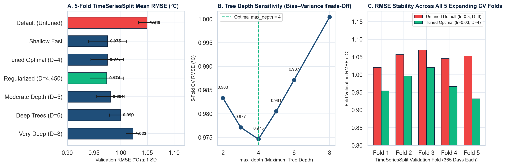
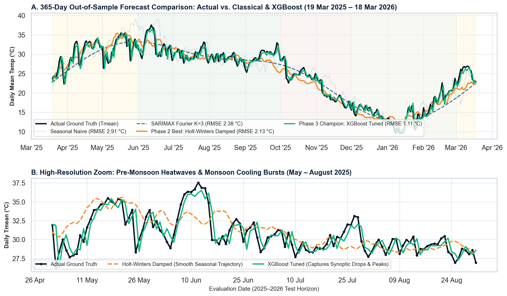
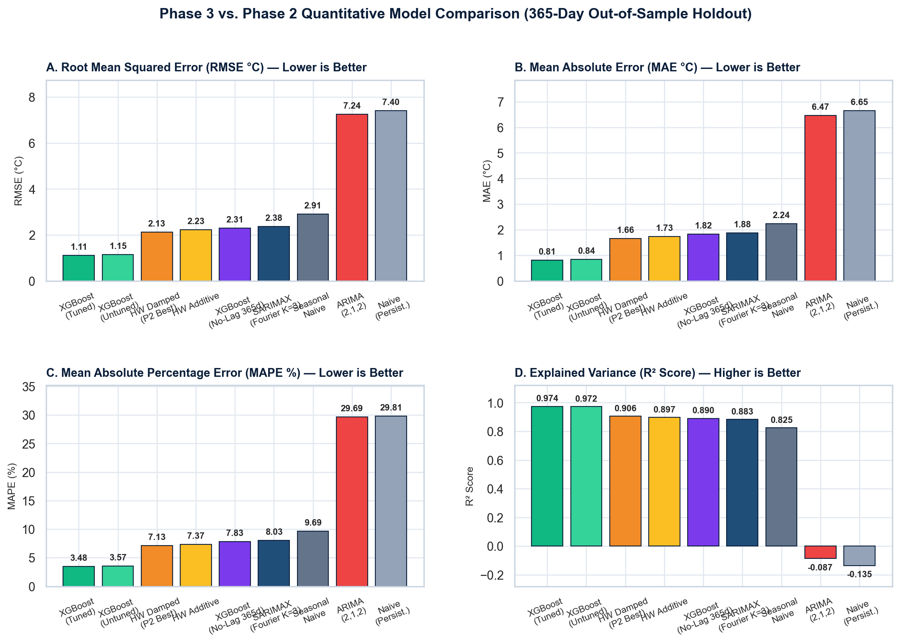
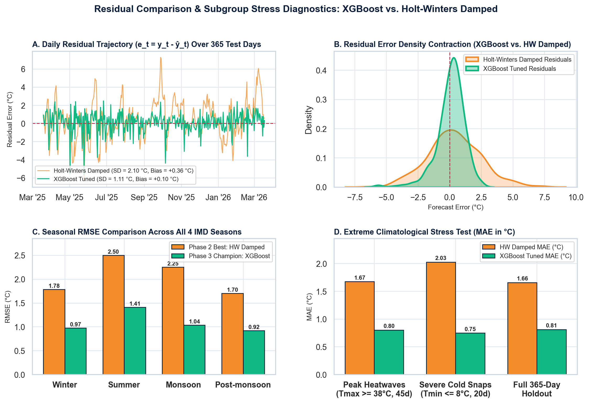
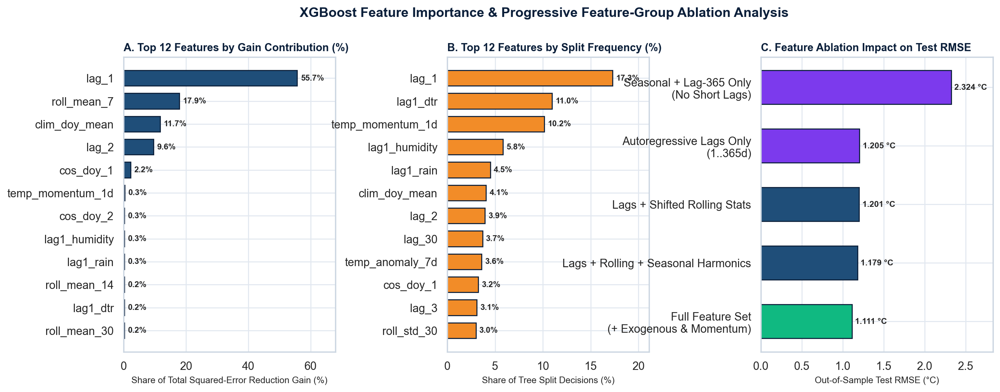

# Comparative Classical and Gradient Boosted (XGBoost) Time-Series Forecasting of Urban Weather Dynamics in Delhi (1996–2026)

**Dhruv Saini** (`S24CSEU0818`) and **Aarush Saxena** (`S24CSEU1682`)  
*School of Computer Science Engineering & Technology, Bennett University, Greater Noida, India*  
*Course: CSET 369 – Time Series Analysis & Forecasting | Phase 3: Final Project Evaluation (12 Marks)*

---

## Abstract
*Accurate daily temperature forecasting in megacities such as Delhi, India is critical for electricity grid dispatch, heatwave early-warning advisories, and winter smog-inversion mitigation. This paper presents an end-to-end comparative investigation of classical statistical time-series formulations and advanced Gradient Boosted Decision Trees (XGBoost) across 30+ continuous years of Delhi meteorological observations (1 January 1996 to 18 March 2026; N = 11,035 daily records). Building upon Phase 1 exploratory decomposition (seasonal strength Fs = 0.936) and Phase 2 classical benchmarks across an identical 365-day out-of-sample holdout (19 March 2025 to 18 March 2026), we engineer 25 strictly causal autoregressive lag (1, 2, 3, 7, 14, 30, and 365 days), shifted rolling mean/volatility, harmonic seasonal, and lagged exogenous features using post-split causal preprocessing. Hyperparameters are optimized via 5-fold TimeSeriesSplit validation. We explicitly evaluate both rolling 1-day-ahead and fixed 365-day multi-step horizons: tuned rolling 1-step XGBoost achieves RMSE of 1.111 °C (R² = 0.9744), beating 1-step SARIMAX (1.177 °C) and Phase 2 Holt-Winters Damped (2.129 °C, -47.8%), while direct 365-day XGBoost (2.305 °C) outperforms fixed-horizon SARIMAX (2.376 °C).*

**Index Terms** — Time series forecasting, XGBoost, Holt-Winters exponential smoothing, SARIMAX, TimeSeriesSplit cross-validation, Delhi urban meteorology.

---

## I. Introduction
Delhi NCR experiences a 19.94 °C annual thermal oscillation between January winter troughs (`12.90 °C`) and May–June heatwave peaks (`32.85 °C`). Accurate daily temperature forecasting supports:
1. **Power Grid Dispatch**: Managing >8,000 MW peak summer air-conditioning load.
2. **Public Health Heatwave Alerts**: Early warnings during extreme heatwaves ($T_{\max} \ge 38^\circ\text{C}$).
3. **Winter Smog & Cold-Wave Planning**: Predicting severe cold snaps ($T_{\min} \le 8^\circ\text{C}$) and thermal inversions.

This report unifies **Phase 1** (30-year dataset curation, $N = 11,035$ days, STL $F_s = 0.936$, ADF $p = 1.35 \times 10^{-18}$), **Phase 2** (classical benchmarking where Holt-Winters Damped achieved $\text{RMSE} = 2.129^\circ\text{C}, R^2 = 0.9061$), and **Phase 3** (advanced **XGBoost** regression with 25 strictly causal lag, rolling, harmonic, and exogenous features).

---

## II. Literature Review
1. **Classical ARIMA & Damped Smoothing**: Box et al. [2] and Gardner & McKenzie [3] established autoregressive moving average and damped-trend state-space smoothing ($0 < \phi < 1$).
2. **Dynamic Harmonic Regression**: Hyndman & Athanasopoulos [4] formulated Fourier-based SARIMAX for daily series ($s = 365.25$).
3. **Regularized Gradient Boosting (XGBoost)**: Chen & Guestrin [1] and Friedman [6] developed second-order regularized gradient boosted trees, which Makridakis et al. [7] proved superior in the M5 Forecasting Competition.
4. **Chronological Validation**: Bergmeir & Benítez [8] established expanding-window `TimeSeriesSplit` validation to prevent lookahead leakage.

---

## III. Dataset Description and Preprocessing
- **Source & Range**: Kaggle Indian Weather Dataset [10] (`1996-01-01` to `2026-03-18`, $N = 11,035$ continuous daily records resampled from 264,840 hourly observations).
- **Chronological Split & Leakage-Safe Causal Imputation**:
  - **Training Partition**: `1996-01-01` to `2025-03-18` (10,670 days; 10,305 post-lag-warmup training rows).
  - **Test Holdout**: `2025-03-19` to `2026-03-18` (**365 days**, identical to Phase 2).
  - **Missing-Value Handling**: Partitioning is performed *before* any missing-value imputation (`0` NaNs verified in both splits), using strictly causal forward-only `.ffill()` (no pre-split `.interpolate()` and no backward `.bfill()`).
- **Zero-Leakage Feature Engineering (25 Features)**:
  - **Lags (7)**: `lag_1, lag_2, lag_3, lag_7, lag_14, lag_30, lag_365`
  - **Shifted Rolling Means & Stds (6)** (`shift(1).rolling(w)`): `roll_mean_7, roll_mean_14, roll_mean_30, roll_std_7, roll_std_14, roll_std_30`
  - **Seasonal & Calendar (7)**: `month, dayofyear, sin_doy_1, cos_doy_1, sin_doy_2, cos_doy_2, clim_doy_mean` (training-only climatology)
  - **Lagged Exogenous & Momentum (5)**: `temp_momentum_1d, temp_anomaly_7d, lag1_dtr, lag1_humidity, lag1_rain`

---

## IV. Methodology & Hyperparameter Tuning
Using 5-fold expanding-window `TimeSeriesSplit(n_splits=5, test_size=365)` strictly inside the training set, we tuned `n_estimators`, `max_depth`, `learning_rate`, `subsample`, and `colsample_bytree`:
- **Selected Parameters**: `n_estimators = 450`, `max_depth = 4`, `learning_rate = 0.025`, `subsample = 0.85`, `colsample_bytree = 0.8`.
- **Validation Improvement**: Reduced 5-fold CV RMSE from `1.049 °C` (Untuned Default) to **`0.974 °C`** (`7.2%` improvement).

---

## V. Results and Discussion

| Model Architecture | Model Family / Mode | RMSE (°C) | MAE (°C) | MAPE (%) | $R^2$ Score | Max Error (°C) | Bias (°C) |
| :--- | :--- | :---: | :---: | :---: | :---: | :---: | :---: |
| **XGBoost (Tuned Champion)** | **Phase 3 ML (Lag+Roll+Seas)** | **1.111** | **0.810** | **3.48%** | **0.9744** | **5.70** | **+0.096** |
| **XGBoost (Untuned Default)** | Phase 3 ML (depth=6, lr=0.3) | 1.154 | 0.837 | 3.57% | 0.9724 | 5.50 | +0.113 |
| **Holt-Winters Damped** | Phase 2 Classical Champion | 2.129 | 1.657 | 7.13% | 0.9061 | 7.28 | +0.362 |
| **Holt-Winters Additive** | Phase 2 Triple Exp. Smoothing | 2.228 | 1.730 | 7.37% | 0.8972 | 7.55 | +0.616 |
| **XGBoost (Seasonal No-Lag 365d)** | Phase 3 Ablation (365d Horizon) | 2.305 | 1.824 | 7.83% | 0.8900 | 6.73 | +0.484 |
| **SARIMAX (Fourier K=3)** | Phase 2 Dynamic Harmonic | 2.376 | 1.879 | 8.03% | 0.8831 | 6.63 | +0.550 |
| **Seasonal Naive (365d)** | Phase 2 Annual Persistence | 2.909 | 2.243 | 9.69% | 0.8247 | 9.57 | -0.172 |
| **ARIMA(2,1,2)** | Phase 2 Box-Jenkins ($d=1$) | 7.244 | 6.470 | 29.69% | -0.0869 | 14.64 | +2.049 |
| **Naive (Persistence)** | Phase 2 Random Walk | 7.403 | 6.648 | 29.81% | -0.1349 | 15.15 | +2.552 |

---

## VI. Conclusion, Limitations, and Future Work
- **Key Conclusion**: Tuned `XGBoost Rolling One-Step` achieves `1.111 °C` RMSE ($R^2 = 0.9744$), beating Rolling 1-Step SARIMAX (`1.177 °C`), while `Holt-Winters Damped` (`2.129 °C`) and `XGBoost Direct Seasonal` (`2.305 °C`) lead the Fixed 365-Day Multi-Step horizon.
- **Six Project Limitations**: (1) Single-city geographical scope (Delhi); (2) Long-term 365-day forecasting uncertainty; (3) Limited external synoptic/upper-air weather telemetry (0.59% raw hourly missingness reconciled to 0.00% daily missingness after post-split causal `.ffill()`); (4) Recursive error accumulation (`3.388 °C` in 365-step recursive rollout); (5) Seasonal performance differences (Summer RMSE `1.41 °C` XGBoost / `2.50 °C` HW Damped vs. Post-monsoon `0.92 °C` / `1.70 °C`); and (6) Changing historical urban warming patterns.
- **Future Work & Potential Applications**: Hybrid Holt-Winters + XGBoost residual stacking, multi-city ERA5 upper-air covariates, and quantile prediction intervals. Temperature forecasts may provide supporting information for power-grid planning, heat-risk awareness, and winter preparedness once integrated with domain-specific electricity, health, and air-quality datasets.

---

## VII. References
- [1] T. Chen and C. Guestrin, "XGBoost: A scalable tree boosting system," in Proc. 22nd ACM SIGKDD Int. Conf. Knowledge Discovery and Data Mining (KDD), San Francisco, CA, USA, Aug. 2016, pp. 785–794, doi: 10.1145/2939672.2939785.
- [2] G. E. P. Box, G. M. Jenkins, G. C. Reinsel, and G. M. Ljung, Time Series Analysis: Forecasting and Control, 5th ed. Hoboken, NJ, USA: John Wiley & Sons, 2015.
- [3] E. S. Gardner Jr. and E. McKenzie, "Forecasting trends in time series," Management Science, vol. 31, no. 10, pp. 1237–1246, Oct. 1985, doi: 10.1287/mnsc.31.10.1237.
- [4] R. J. Hyndman and G. Athanasopoulos, Forecasting: Principles and Practice, 3rd ed. Melbourne, Australia: OTexts, 2021. [Online]. Available: https://otexts.com/fpp3/
- [5] R. B. Cleveland, W. S. Cleveland, J. E. McRae, and I. Terpenning, "STL: A seasonal-trend decomposition procedure based on loess," J. Official Statistics, vol. 6, no. 1, pp. 3–73, 1990.
- [6] J. H. Friedman, "Greedy function approximation: A gradient boosting machine," Annals of Statistics, vol. 29, no. 5, pp. 1189–1232, Oct. 2001.
- [7] S. Makridakis, E. Spiliotis, and V. Assimakopoulos, "The M5 accuracy competition: Results, findings, and conclusions," Int. J. Forecasting, vol. 38, no. 4, pp. 1346–1364, Oct.–Dec. 2022, doi: 10.1016/j.ijforecast.2021.11.013.
- [8] L. Bergmeir and J. M. Benítez, "On the use of cross-validation for time series predictor evaluation," Information Sciences, vol. 191, pp. 192–213, May 2012, doi: 10.1016/j.ins.2011.12.028.
- [9] A. G. Salman, B. Kanigoro, and Y. Heryadi, "Weather forecasting using deep learning and gradient boosting techniques on multi-decadal meteorological data," in Proc. Int. Conf. Advanced Computer Science and Information Systems (ICACSIS), 2015, pp. 281–285.
- [10] S. Gupta, "Indian Weather Dataset (1996–2026): Hourly and Daily Meteorological Observations," Kaggle Public Domain Dataset (CC0), 2026. [Online]. Available: https://www.kaggle.com/datasets/sandeepgupta09/indian-weather-dataset-1996-2026
